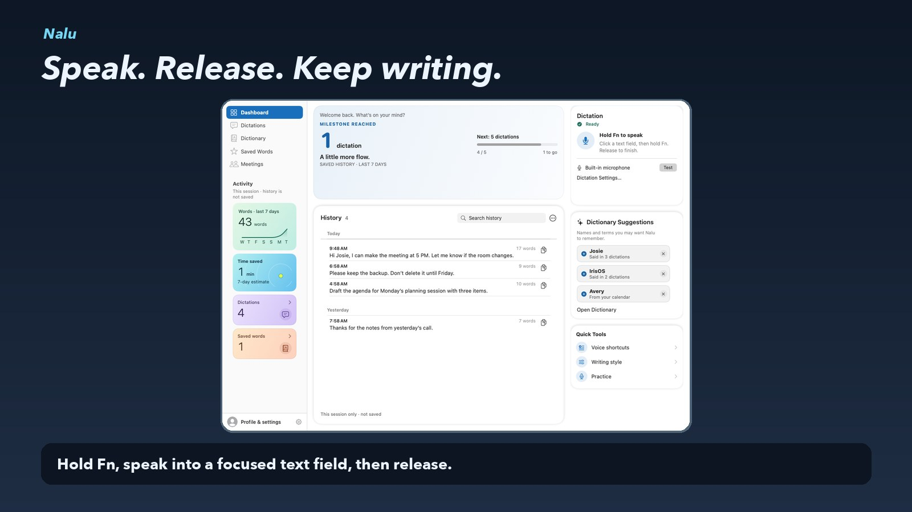
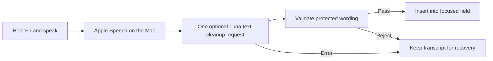

# Nalu

**Native macOS dictation with on-device speech recognition and validated AI cleanup.**

Hold Fn, speak into a focused text field, and release. Nalu transcribes speech on the Mac, sends the transcript for one optional cleanup pass, then checks the result before inserting it. If cleanup fails, the app retains the recognized words and offers Use Original, Retry, or Copy.

[](media/nalu-demo.mp4)

[Watch the narrated walkthrough](media/nalu-demo.mp4) · [Download the MP4](https://github.com/JoshuaColePhD/Nalu-Portfolio/releases/download/demo-v1/nalu-demo.mp4) · [Transcript](media/transcript.md)

The walkthrough uses native Nalu captures with synthetic dictations. The focused editor sequence illustrates the insertion flow.

## How it works



Nalu uses Swift, SwiftUI, and AppKit. Apple Speech handles transcription on the Mac. The managed cleanup path sends text and limited writing hints through an authenticated Node service to the OpenAI Responses API. The client checks protected numbers, negation, contractions, and code identifiers before insertion. Dictation history uses an encrypted local archive.

## What the benchmarks changed

**I shipped a faster cleanup path.** Nine generated-speech trials put median key-release-to-simulated-insertion time at **1,427 ms**, with **1,315 ms** spent waiting on cleanup. In a separate matched-input test, I compared Luna Fast with the existing request tier configuration. All **36 requests** passed quality checks, and all 18 Fast responses confirmed the served tier.

| Cleanup HTTP latency | Existing request | Luna Fast |
| --- | ---: | ---: |
| Median | 1,135.5 ms | 971.5 ms |
| p95 | 2,131 ms | 1,457 ms |

The median fell **14.4%**. These timings cover HTTP cleanup on synthetic fixtures. The generated-speech trial measured simulated insertion. [Benchmark method and evidence](evidence/benchmarks.md)

**I held a recognition prompt update.** The candidate passed **8 of 8 targeted cases** for false starts, clear mishearings, and wording preservation. The broader run passed 20 cases before stopping at an exact paragraph-formatting mismatch. The live prompt reproduced that mismatch and already fixed “spinning” to “spending” in the budget example. I kept the live prompt in production because the candidate had yet to clear the full gate or show a gain on the motivating example. [Prompt decision and case results](evidence/benchmarks.md#recognition-prompt-decision)

## Explore the evaluation

Run the included deterministic demo-cleanup evaluation with Python 3.10+.

```sh
python3 eval/cleanup_eval.py
```

The 12 synthetic fixtures score the bundled sample cleaner against hand-labeled references. The sample cleaner recorded **5 word errors across 42 reference words**, compared with **10** in the raw transcripts. The production Luna results come from the separate benchmarks above.

This public repository is a portfolio showcase with a walkthrough, benchmark evidence, and a runnable evaluation example. Nalu’s production app and account service live in a private repository.
