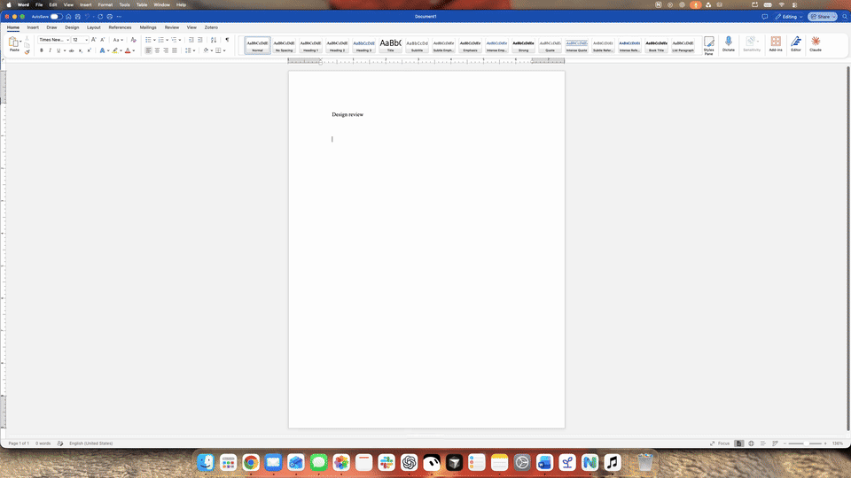

# Nalu

**Dictate into the Mac app you’re using.**

Hold Fn, speak, and release. Nalu transcribes on your Mac, optionally cleans up the text with AI, and checks important details such as numbers and negation before inserting it into the focused app.

## Demo

**[Watch the 11-second showcase (MP4)](media/nalu-showcase.mp4)** · [Watch the full native recording](https://github.com/JoshuaColePhD/Nalu-Portfolio/releases/download/live-demo-v1/nalu-word-demo.mp4) · [Try the browser sample](https://joshuacolephd.github.io/Nalu-Portfolio/) · [Engineering case study](docs/engineering.md)

The video combines a full-screen Word screenshot with the document text and Nalu indicator animation from a real recorded dictation. The video is silent. The indicator is positioned above the Dock, and its Word icon is replaced with a sharper copy. The full-screen layout is composited; it is not a continuous screen recording. The additional sentences shown after the recorded result are illustrative text, not part of the spoken take. The browser sample uses fixed local rules, without AI.

The native app and service source are private. Public sample code and recorded benchmarks are included here. This is an engineering portfolio, not an app download.

## What I built

I lead product and engineering decisions, with AI assistance in implementation and verification.

- Built dictation into the current app, with checks for changed details and recovery when cleanup or insertion fails.
- Connected the OpenAI Responses API with timeouts, versioned prompts, cost tracking, and timing logs.
- Compared cleanup changes on matched inputs and used broader tests to decide which updates to release or hold.

## Engineering decisions

**Validate before insertion.** Checks flag changed numbers and negation, while recovery handles cleanup or insertion failures. These checks constrain edits; they do not prove identical meaning.

**Hold changes without sufficient evidence.** A prompt update passed **8/8 targeted checks**, but broader testing recorded **20 passes, one failure, and three unrun cases**. I held it: the existing prompt already fixed the motivating mishearing, and the formatting mismatch remained unresolved.

## Results

| Measure | Original request | Fast request |
| :--- | ---: | ---: |
| Median request time | 1,135.5 ms | 971.5 ms |
| 95th-percentile time | 2,131 ms | 1,457 ms |
| Synthetic quality checks | 18/18 | 18/18 |

In two rounds of nine synthetic inputs on October 28, 2026, median service-request time decreased **14.4%**. Both arms included the same accounting experiment. The final service restored serial accounting; its speed was not remeasured. These measurements exclude full microphone-to-editor latency. [Methods and limitations](evidence/benchmarks.md)

## How it works

Capture → transcribe on the Mac → optional cloud cleanup → validate → insert.

Swift and Apple Speech handle the native workflow. The Node.js service records provider token usage in PostgreSQL and estimates costs; stage timings expose where requests wait. [Architecture, metering, and limitations](docs/engineering.md).

## Explore further

[Reproduce the recorded results](evidence/README.md) with Python and no API key. The offline checks verify sample behavior and recorded statistics; they do not rerun the AI service.
