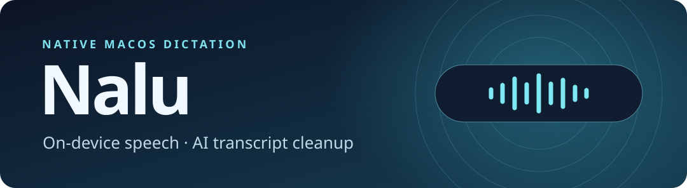
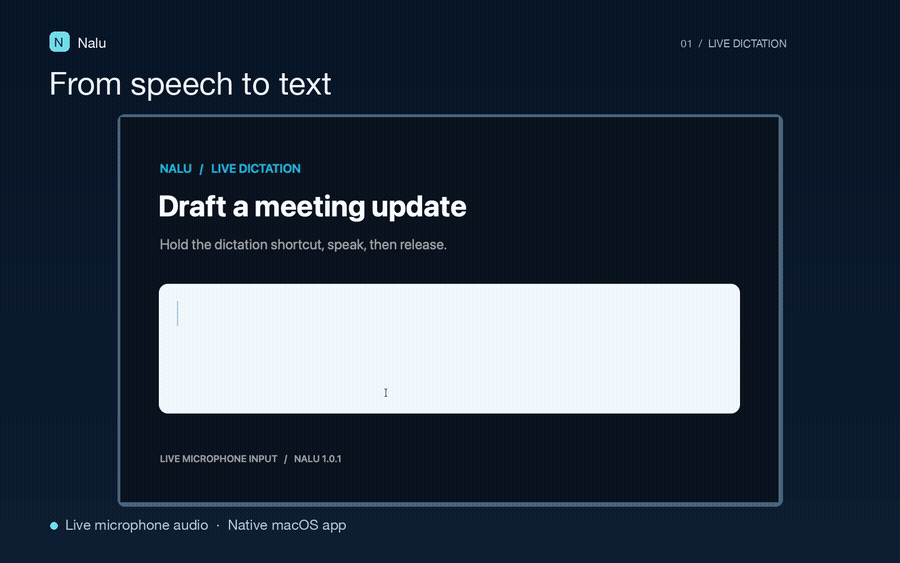

**[▶ Try the browser demo](https://joshuacolephd.github.io/Nalu-Portfolio/)** · **[Watch live dictation · 10 sec](https://github.com/JoshuaColePhD/Nalu-Portfolio/releases/download/live-demo-v1/nalu-live-dictation.mp4)** · [Dock pill animation · 8 sec](https://github.com/JoshuaColePhD/Nalu-Portfolio/releases/download/live-demo-v1/nalu-dock-pill-illustration.mp4) · [Dashboard image](media/poster.jpg)

I built Nalu to turn speech into text in the focused Mac app. Hold Fn, speak, and release. Nalu transcribes on-device, cleans up the transcript, and checks protected details like numbers and negation before pasting.

The browser demo runs without an account. The native app and sign-in are private. [45-second walkthrough](media/nalu-demo.mp4)

## Engineering results

| Benchmark | Baseline | Luna Fast |
| :--- | ---: | ---: |
| Median cleanup latency | 1,135.5 ms | **971.5 ms · 14.4% lower** |
| p95 cleanup latency | 2,131 ms | **1,457 ms** |

All **36 requests** passed quality checks on matched synthetic inputs.

**Release decision.** A new cleanup prompt passed **8/8 targeted tests**. I held it after the broader suite hit a formatting regression and the existing prompt already fixed the motivating mishearing. [Methods and regression results](evidence/benchmarks.md)

**Stack.** Swift · SwiftUI · AppKit · Apple Speech · Node.js · OpenAI Responses API

**Run the offline evaluation.** `python3 eval/cleanup_eval.py` checks 12 synthetic fixtures with Python 3.10+ and requires no account or API key.
