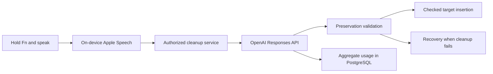

# Nalu: making dictation cleanup measurable

Nalu's product promise is simple: speak into the app you are already using. The engineering challenge is to make cleanup useful without silently changing a price, a negation, or the destination of the text. Joshua Cole directs the product and engineering decisions; development uses AI assistance. This case study describes inspected private implementation and recorded synthetic experiments, with public artifacts linked below.

## Architecture

Native Swift components separate transcription, cleanup, networking, insertion, and recovery. The recording session retains its settings and target. The Node.js service keeps provider credentials on the server, bounds requests, identifies the model/prompt, and validates output. The application retains a recovery path when cleanup or delivery fails. The public browser demo deliberately illustrates only a deterministic cleanup interaction; it cannot exercise this native pipeline.

Preservation checks protect quantities, negation, contractions, and protected wording. They are useful constraints, not a proof of semantic equivalence. The frozen corpus includes ambiguous `42nd` wording that must not be guessed into a duration, negation, numbers, dictionary spelling, disabled filler removal, and longer paragraphs. References are expected outputs or criteria; model response text is not published.

## Two decisions, two kinds of evidence

**Choose a lower-latency service tier.** The recorded comparison alternated baseline and Fast order over two rounds of nine synthetic inputs. Both arms received matching inputs, verified by SHA-256. All 36 recorded requests passed their original quality checks. Median HTTP time fell from 1,135.5 to 971.5 ms; p95 fell from 2,131 to 1,457 ms. The baseline's served tier was unknown, so the comparison is against its request configuration, not a verified Standard-tier treatment.

Both paired arms contained the same accounting-overlap experiment. That experiment did not independently establish a speed gain. The final Fast candidate restored serial accounting and passed nine separate quality checks; the paired speed experiment was not repeated after that restoration. Consequently, the 14.4% result belongs to the recorded experiment. It is not a measured final-production or microphone-to-editor improvement.

**Hold a promising prompt.** A revised recognition prompt passed eight targeted cases, including a motivating sound-alike error. The broader 24-case suite stopped after 20 passes and one paragraph-formatting failure, leaving three cases unrun. A separate run reproduced the mismatch on the existing prompt, which also corrected the motivating mishearing. The candidate stayed in staging. That decision avoids treating a favorable small test as sufficient release evidence. [Recorded results and method](../evidence/benchmarks.md)

## Cost and observability

The private implementation inspected on November 4, 2026 records provider-reported input, output, and cached token counts, with service-tier-aware estimates. Unknown pricing or unsupported usage yields an unknown estimate rather than a fabricated zero. Reported usage is counted even when a response is incomplete. Parameterized SQL aggregates usage by day and model; estimates exclude hosting, database costs, taxes, and gateway adjustments. This is evidence of accounting behavior, not a current price quote. The published latency rows do not contain token totals, so this portfolio makes no measured cost-per-request claim for that experiment.

Native diagnostics report bounded timing stages and failure categories. The [sanitized service trace](../evidence/stage-timings.json) records authentication, account lookup, rate checking, reservation, provider, metering, and commit durations for the same 36 HTTP requests. These partial stages are not assumed to sum to wall-clock request time. No transcript, credential, account identifier, or private deployment URL is included.

## Reproduce and extend

Run `python3 eval/benchmark_report.py --check` from the repository. It checks the recorded measurement grid, original input hashes, stage identities, frozen artifact hashes, and published totals. `--json` emits the computed summary. It verifies recorded pass flags; it cannot independently validate the unavailable model responses. The frozen corpus permits inspection and a future separately labeled inference experiment, but this repository does not include the private runner or production validator.

The next useful measurement is consented, varied-speaker microphone-to-editor evaluation with edit acceptance and meaning-preservation labels. A larger held-out corpus and a repeated final-configuration comparison would strengthen the current small synthetic evidence. Preserve the existing snapshots when adding such results. [Evidence and provenance index](../evidence/README.md)
